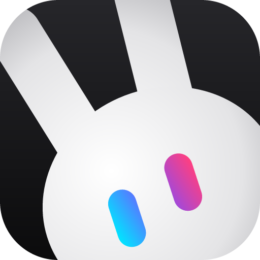

<div align="center">
  
  <h1>PadkaHub(RikkaHub)</h1>

A tablet-first build based on RikkaHub — a floating assistant ball, an always-on-top chat window, region screenshot annotation and a stylus-friendly sketch board.

[简体中文](README_ZH_CN.md) | [繁體中文](README_ZH_TW.md) | English
</div>

> [!NOTE]
> This is an **unofficial fork** of [rikkahub/rikkahub](https://github.com/rikkahub/rikkahub), tracking upstream **3.3.0**.
> Everything upstream offers is kept; on top of that this fork adds a set of features aimed at large-screen
> devices used with a stylus (developed and tested on Xiaomi Pad 6 + Xiaomi Smart Pen).
> It is not affiliated with the RikkaHub author. If the original app already fits your needs, please use it.

## 🚀 Download

- Latest APK: [**Releases**](https://github.com/N1H1-4/rikkahub-floatingball/releases) — `arm64-v8a`, Android 8.0+
- Package name is `me.rerere.rikkahub.fb`, so this fork **can be installed alongside** the official RikkaHub
  without touching its data
- Requirements: Android 8.0+. In-app update checks this repository's releases.

## ✨ Added in this fork

### 🐰 Floating ball

The desktop pet and the old "generating" bubble are merged into one ball that stays on top of everything.

- Avatar is customizable (photo / emoji / image URL / built-in pattern), with size, opacity, edge docking and
  half-hidden docking
- While the AI is generating, the ball morphs into an animated shape
- **Tap**: expands the floating chat window if a conversation is being tracked, otherwise starts a region
  screenshot — the tap action can be changed in settings
- **Long press**: opens a half-circle menu on the inner side of the screen with up to 5 actions; tapping the
  ball in the centre closes it
- History conversations and assistant switching open as a small list layer next to the ball, instead of
  jumping back into the app

Available actions: new floating chat · conversation history · open PadkaHub · full-screen capture & ask ·
region capture · close floating ball · open settings · statistics · switch assistant.

### 💬 Floating chat window

- Draggable, and resizable by dragging the bottom-right handle — width and height can both go up to
  near-full-screen
- Shows the conversation history with Markdown and LaTeX support, so you can keep reading without leaving
  your current app
- Composer keeps quick messages, model switching and reasoning depth
- A "open floating window" button was added to the chat top bar to pop the current conversation out at once

### ✂️ Region screenshot → ask

- Select a region, annotate it, then send it to a conversation
- Aspect ratio presets, brush/colour, undo & redo
- Four exits: copy to clipboard · save to gallery · send to a new chat · send to an existing chat
- Full-screen capture skips the editor and opens the chat with the image already attached

### 🖊️ Sketch board for stylus

- **Stylus-only** input mode by default, so a resting palm or finger never leaves a mark; switchable to a
  finger-friendly mode
- In stylus mode, one finger pans and two fingers pinch-zoom the canvas (1×–4×)
- Six brushes including pressure-sensitive pen and calligraphy

### 📤 Share to a new chat

- Share images, documents, PDF and Office files from any app; pick an assistant and land in a fresh
  conversation with the attachments already there

## 📚 Inherited from upstream

Material 3 Expressive design · multiple AI providers (OpenAI / Google / Anthropic compatible custom
API / URL / models) · MCP and Skills · workspace (proot-based Linux agent environment) · Phone Use ·
media generation · web access · Markdown rendering (code highlight, LaTeX, tables, Mermaid) · search
providers · QR code export & import for providers · assistant customization · file-based memory ·
AI translation · custom HTTP headers and bodies · SillyTavern character card import.

## ⚠️ Known limitations

- Pen barrel buttons are not supported on HyperOS: the system does not report `buttonState` to apps, so
  pen-button shortcuts cannot be implemented
- The canvas only pans after zooming in; at 1× the paper exactly fits the screen
- The release APK targets `arm64-v8a`; a debug build for other ABIs can be built from source
- In-app updates are shipped from this repository's releases, not from the official update server

## 🛠️ Build

Requirements: JDK 21+, Android SDK Platform 37 (with minor API level 2), Node 22+ and pnpm 11.

```bash
# web module bundles a React frontend, install it once
cd web-ui && pnpm install --frozen-lockfile && cd ..

# google-services.json is required by the google-services plugin
# (a placeholder file is enough for local builds)

./gradlew assembleGithubDebug   # debug APK, package name me.rerere.rikkahub.debug
./gradlew assembleGithubRelease # release APK (needs signing config in local.properties)
```

Release signing reads `storeFile` / `storePassword` / `keyAlias` / `keyPassword` from `local.properties`.

### Syncing with upstream

```bash
git remote add upstream https://github.com/rikkahub/rikkahub.git
git fetch upstream
git merge upstream/master
```

## 🙏 Credits

- Original project: [rikkahub/rikkahub](https://github.com/rikkahub/rikkahub) by [re-ovo](https://github.com/re-ovo)
- Floating windows are built on [FloatingX](https://github.com/Petterpx/FloatingX)
- Icons from [HugeIcons](https://hugeicons.com/), sketch rendering on [androidx.ink](https://developer.android.com/jetpack/androidx/releases/ink)

## 📄 License

Licensed under the [GNU Affero General Public License v3.0](LICENSE) (AGPL-3.0), the same license as the
original project. Modified sources of this fork are published in this repository.
